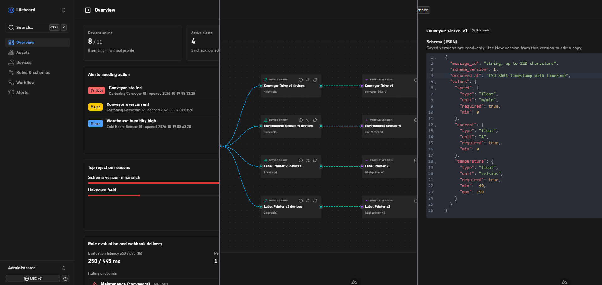

# LiteBoard

**LiteBoard** is a developer-first IoT / IIoT (Industrial Internet of Things) control plane platform designed for MQTT-connected devices, industrial automation, and smart factory telemetry.

It provides a multi-tenant hierarchy (`Tenants` -> `Projects` -> `Factories` -> `Production Lines`), device management, telemetry streaming, and an interactive flow dashboard.



---

## Architecture & Project Structure

The repository is organized as a monorepo containing the modular backend, modern web dashboard, telemetry ingestion pipeline, and edge simulator:

```text
LiteBoardv2/
├── backend/               # Laravel 13 Control-Plane API (Modular Monolith)
│   ├── app/               # Host-level providers & infrastructure tooling
│   ├── database/          # Forward-only database migrations & seeders (PostgreSQL)
│   ├── modules/           # Domain business modules
│   │   ├── Core/          # Auth, Sanctum tokens, Tenancy, User management
│   │   └── Masterdata/    # Projects, Factories, Production Lines CRUD & business logic
│   └── tests/             # Automated test suite (Pest & PHPStan)
│
├── web/                   # Frontend Dashboard (Nuxt 4, Vue 3, Nuxt UI v4)
│   ├── app/
│   │   ├── components/    # Vue components (TenantHierarchyFlow, Modals, Tables)
│   │   ├── composables/   # Reusable state & utilities (useApi, useAuth, useDateTime)
│   │   ├── pages/         # Nuxt file-based routing (Masterdata, Tenants, Settings)
│   │   └── types/         # Zod schemas and TypeScript data contracts
│   └── package.json       # Frontend dependencies (Nuxt, VueFlow, Tailwind v4)
│
├── telemetry-service/     # FastAPI / Python MQTT subscriber and presence service
│   ├── app/               # Validates messages and updates Device presence
│   └── Dockerfile
│
├── simulator/             # IoT device simulator for testing telemetry streams
│   ├── app/               # MQTT metric generation scripts
│   └── Dockerfile
│
├── infrastructure/        # Infrastructure configs (Eclipse Mosquitto MQTT broker)
│   └── mosquitto/
│
├── docs/                  # architecture.md, plan.md, setup/ (how to run), spec/ (per-area specs)
│
├── AGENTS.md              # Repository guidelines, rules, and testing standards
├── docker-compose.yml     # Multi-service local deployment orchestrator
└── README.md              # Project entry point
```

---

## Core System Principles

1. **Multi-Tenancy**: Tenant-owned data is isolated across models, queries, authorization policies, cache, and UI views.
2. **Strict Data Contract Integrity**: Single source of truth across all layers with no ad-hoc coercions, multi-source fallbacks (`??`), or shadow fields.
3. **UTC+0 Storage Invariant**: Database columns and backend APIs strictly use UTC (`UTC+0`). Localized date/time display is handled exclusively by client-side composables.
4. **Forward-Only Migrations**: Database schemas evolve forward; `down()` methods are disallowed.
5. **Quality Gates**: Every change must satisfy PHPStan (level 8/max), Pest tests, Pint formatting, Nuxt typechecking, and ESLint.

---

## Documentation

| Topic | Document |
|---|---|
| Architecture, components, ports, keys | [docs/architecture.md](docs/architecture.md) |
| Master plan and system specification | [docs/plan.md](docs/plan.md) |
| Run everything with Docker, root `.env` | [docs/setup/docker.md](docs/setup/docker.md) |
| Backend / Web / Telemetry service | [backend](docs/setup/backend.md) · [web](docs/setup/web.md) · [telemetry-service](docs/setup/telemetry-service.md) |
| Mosquitto broker (TLS, auth, ACL) | [docs/setup/mosquitto.md](docs/setup/mosquitto.md) |
| ESP32 firmware | [docs/setup/esp32.md](docs/setup/esp32.md) |
| Spec conventions (`current/` vs `plan/`) | [docs/spec/conventions.md](docs/spec/conventions.md) |
| Tenant, Project, Asset | [README](docs/spec/tenant/README.md) · [master data](docs/spec/tenant/current/tenant-project-asset.md) · [tenant management](docs/spec/tenant/current/tenant-management.md) |
| Auth | [README](docs/spec/auth/README.md) · [authentication](docs/spec/auth/current/authentication.md) · [access control](docs/spec/auth/current/access-control.md) · [backend ↔ telemetry](docs/spec/auth/current/telemetry-service-auth.md) |
| Devices | [README](docs/spec/devices/README.md) · [Access Token](docs/spec/devices/current/devices_access_token.md) · [roadmap](docs/spec/devices/plan/future_device_security_and_ingestion_plan.md) · [phase 7](docs/spec/devices/plan/phase-7-mqtt-tls-server-certificate.md) · [phase 8](docs/spec/devices/plan/phase-8-quotas-and-rate-limiting.md) · [phase 9](docs/spec/devices/plan/phase-9-schema-validation-and-replay-protection.md) |
| Industrial telemetry | [README](docs/spec/industrial-telemetry/README.md) · [telemetry flow](docs/spec/industrial-telemetry/current/telemetry-flow.md) · [phase 6: EAMO](docs/spec/industrial-telemetry/plan/phase-06-eamo-integration.md) |
| MQTT IDS (research) | [README](docs/spec/mqtt-ids/README.md) · [POC plan](docs/spec/mqtt-ids/plan/mqtt-ids-poc.md) |
| Mandatory rules | [Data contract integrity](docs/DATA_CONTRACT_INTEGRITY_RULE.md) · [Request handling](docs/Request_Handling.md) · [Backend modules](docs/modules.md) |

---

## Getting Started

Follow [docs/setup/docker.md](docs/setup/docker.md) for local setup, environment files, and the internal telemetry MQTT password.

---
## Quality Checks & Testing

Before committing code, ensure all quality gates pass:

### Backend Quality Gates
```powershell
cd backend

# Static Analysis
composer stan

# Automated Tests
php artisan test --compact

# Code Styling Formatter
composer pint

# Run dev server
php artisan serve --host=0.0.0.0 --port=8800
```

### Frontend Quality Gates
```powershell
cd web

# TypeScript Type Checking
pnpm typecheck

# Code Linter
pnpm lint
```

---

## License

This project is licensed under the MIT License. See [LICENSE](LICENSE) for details.
