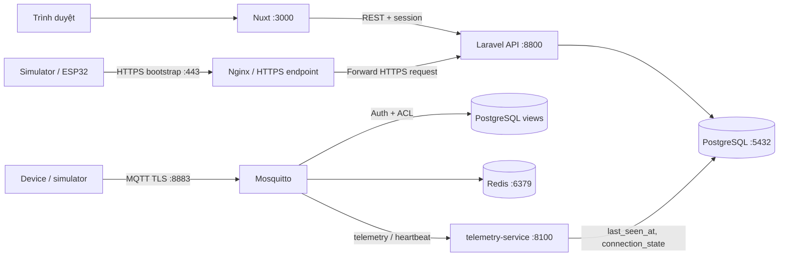

# LiteBoard: bản đồ kỹ thuật và chạy local

Tài liệu này là điểm bắt đầu để hiểu các thành phần, biết lệnh nào cần chạy và tìm đúng file cấu hình. Nếu chỉ muốn chạy dự án local, hãy dùng mục **Khởi chạy nhanh bằng Docker**.

## Tóm tắt trong một phút

- `web/` là dashboard Nuxt; `backend/` là Laravel API và nơi xử lý đăng nhập, phân quyền, tenant/project và dữ liệu nghiệp vụ.
- Thiết bị gửi MQTT qua **TLS cổng `8883`** vào Mosquitto. MQTT plaintext `1883` và WebSocket `9001` không được mở.
- `telemetry-service/` nhận telemetry từ broker và cập nhật trạng thái online/last-seen của Device. Hiện service **chưa lưu payload telemetry vào bảng lịch sử**.
- PostgreSQL lưu dữ liệu ứng dụng; Redis được Mosquitto dùng cho cache xác thực/ACL với TTL 5 giây.
- Thiết bị đăng nhập MQTT bằng Access Token. Provisioning tự tạo Device ở trạng thái chờ duyệt; broker chỉ cho Device kết nối sau khi được Project duyệt.

## Các thành phần

| Thư mục / service | Vai trò | Khi nào cần chạy |
|---|---|---|
| `web/` — Nuxt 4 | Dashboard trên trình duyệt, gọi Laravel API | Luôn cần để dùng giao diện |
| `backend/` — Laravel 13 | API, Sanctum/session auth, tenant context, phân quyền và dữ liệu Device/Project/Asset | Luôn cần |
| `postgres` — PostgreSQL 16 | Database cho backend, thông tin Device/credential, view xác thực MQTT và trạng thái Device | Luôn cần |
| `redis` — Redis 7 | Cache auth/ACL của Mosquitto | Luôn cần cho cấu hình broker hiện tại |
| `mosquitto` — Mosquitto + `mosquitto-go-auth` | MQTT TLS listener, xác thực Access Token và ACL theo Device/topic | Cần khi có thiết bị hoặc simulator gửi MQTT |
| Reverse proxy (deployment) | Nhận HTTPS provisioning và chuyển tiếp tới Laravel | Dùng Nginx hoặc reverse proxy có certificate hợp lệ khi kiểm thử HTTPS/deploy |
| `telemetry-service/` — FastAPI + gmqtt | Subscribe telemetry/heartbeat, kiểm tra topic/JSON rồi cập nhật `connection_state` và `last_seen_at` | Cần cho luồng Device presence |
| `simulator/` | Python publisher để tạo telemetry mẫu; có thêm sketch ESP32 | Chỉ chạy khi cần thử luồng thiết bị |

### Luồng dữ liệu hiện tại



Tenant/project context được xử lý ở Laravel; credential của Device chỉ được phép truy cập topic tương ứng theo ACL của broker. Các service trong Docker liên lạc bằng tên service như `postgres`, `redis`, `backend`; `localhost` bên trong một container chỉ trỏ về chính container đó.

## Khởi chạy nhanh bằng Docker

### Yêu cầu

- Docker Desktop đang chạy và Docker Compose v2.
- OpenSSL 1.1.1 trở lên để tạo CA/chứng chỉ development.
- Không cần cài PHP, Composer hoặc Node nếu chạy toàn bộ bằng Docker.

### 1. Tạo file cấu hình local

Từ thư mục gốc repo, nếu chưa có `.env`, tạo từ mẫu bằng PowerShell. Nếu `.env` đã tồn tại, giữ file đó và thêm các biến còn thiếu từ mẫu; không ghi đè secret đang dùng.

```powershell
if (-not (Test-Path .env)) { Copy-Item .env.example .env }
```

File `.env` gốc dành cho Docker Compose. Đổi các giá trị `change-me` thành giá trị riêng cho máy local; không commit `.env`.

### 2. Tạo chứng chỉ TLS development

```powershell
powershell.exe -NoProfile -ExecutionPolicy Bypass -File .\infrastructure\mosquitto\generate-dev-certs.ps1
```

Script tạo CA, chứng chỉ server Mosquitto và header CA công khai cho sketch ESP32. Private key không được đưa vào Git hoặc firmware. Chứng chỉ mặc định có tên `mqtt.local` và IP mẫu `192.168.1.100`; nếu PLC/ESP32 dùng hostname hoặc IP khác, thêm đúng tên/IP vào SAN ở lần tạo đầu tiên, ví dụ `-IpAddress @('127.0.0.1','192.168.1.50')`. Xem [hướng dẫn Mosquitto](../infrastructure/mosquitto/README.md) để biết chi tiết.

Chạy script một lần cho bộ certificate local. Nếu certificate đã tồn tại, script sẽ từ chối ghi đè.

### 3. Sinh `APP_KEY` riêng cho Laravel

Chạy từ thư mục gốc sau khi Docker Desktop hoạt động:

```powershell
docker compose run --build --rm --no-deps backend php artisan key:generate --show
```

Chép giá trị lệnh trả về vào `APP_KEY` trong file `.env` gốc. Đây là key của Laravel, không phải MQTT Access Token hay TLS key. Giữ riêng cho từng môi trường và không commit.

### 4. Khởi chạy

```powershell
docker compose --profile containerized-frontend up -d --build
docker compose ps
```

Lệnh này chạy database, Redis, Mosquitto, Laravel API, telemetry-service và Nuxt dashboard. Backend chạy migration khi khởi động container. Xem log khi cần:

```powershell
docker compose logs -f backend mosquitto telemetry-service frontend
```

### 5. Mở các dịch vụ

| Mục đích | Địa chỉ local | Ghi chú |
|---|---|---|
| Dashboard | `http://localhost:3000` | Nuxt, Compose profile `containerized-frontend` |
| Laravel API health | `http://localhost:8800/api/health` | Backend/control plane |
| Telemetry health | `http://localhost:8100/health` | Ingestion/presence service |
| MQTT broker | `mqtt.local:8883` | MQTT qua TLS; client phải tin cậy CA và xác minh hostname |
| PostgreSQL | `localhost:5432` | Kết nối từ máy host; container dùng `postgres:5432` |
| Redis | `localhost:6379` | Kết nối từ máy host; container dùng `redis:6379` |

Broker chỉ có TLS `8883`. Không cấu hình client sang `1883` hoặc `9001`. `mqtt.local` là alias trong Docker network; thiết bị ngoài Docker cần DNS/hosts trỏ hostname về máy chạy broker, hoặc dùng IP có trong SAN của chứng chỉ. Không tắt hostname verification để né lỗi certificate.

## Cổng host và cổng nội bộ

| Biến / port | Ý nghĩa |
|---|---|
| `POSTGRES_PORT` → container `5432` | Cổng host được publish để máy local truy cập PostgreSQL. Service trong Docker vẫn dùng `postgres:5432`. |
| `REDIS_PORT` → container `6379` | Cổng host được publish để máy local truy cập Redis. Service trong Docker vẫn dùng `redis:6379`. |
| `BACKEND_PORT` → container `8800` | Cổng host của Laravel API. |
| `TELEMETRY_PORT` → container `8100` | Cổng host của health endpoint telemetry-service. |
| `FRONTEND_PORT` → container `3000` | Cổng host của Nuxt nếu chạy bằng Compose profile. |
| MQTT `8883` | Listener TLS của broker, hiện publish cố định. Không có listener `1883` hay `9001`. |
| `MQTT_PG_PORT` | Cổng PostgreSQL mà Mosquitto và telemetry-service gọi; với PostgreSQL trong Compose giữ `5432`. |
| `MQTT_REDIS_PORT` | Cổng Redis mà Mosquitto dùng cho cache; với Redis trong Compose giữ `6379`. |

Khi một cổng host đã được ứng dụng khác sử dụng, đổi biến host tương ứng trong `.env`, ví dụ `POSTGRES_PORT=5433`. Không đổi `MQTT_PG_PORT` hoặc `MQTT_REDIS_PORT` nếu chỉ muốn đổi cổng host.

## Các file môi trường và key

| File / biến | Dùng cho |
|---|---|
| `.env` ở repo root | Docker Compose: port publish, PostgreSQL, service MQTT, simulator và đường dẫn certificate. Mẫu là [.env.example](../.env.example). |
| `backend/.env` | Chỉ dùng khi chạy Laravel trực tiếp trên máy host thay vì container. Mẫu là [backend/.env.example](../backend/.env.example). |
| `web/.env` | Chỉ dùng khi chạy Nuxt trực tiếp trên máy host. Mẫu là [web/.env.example](../web/.env.example); API mặc định `http://localhost:8800`. |

Các key không thay thế cho nhau:

| Giá trị | Ý nghĩa |
|---|---|
| `APP_KEY` | Key mã hóa của Laravel. Sinh riêng bằng lệnh ở bước 3. |
| `POSTGRES_PASSWORD` | Mật khẩu tài khoản database dùng bởi các service local. |
| `MQTT_INTERNAL_PASSWORD` | Mật khẩu service account mà telemetry-service dùng để subscribe broker. |
| `MQTT_HEALTHCHECK_PASSWORD` | Mật khẩu riêng cho healthcheck của Mosquitto. |
| Device `ACCESS_TOKEN` | Credential của một Device; MQTT hiện gửi token ở cả username và password. Chỉ điền vào simulator khi cần thử Device đó. |
| `MQTT_TLS_KEY_FILE` | Private key của chứng chỉ server broker. Giữ trên máy/server broker; không đưa vào Git hoặc firmware. |
| `MQTT_TLS_CA_SOURCE` | CA certificate công khai mà client tin cậy để xác minh broker; firmware chỉ chứa CA công khai. |

`MQTT_TLS_HOSTNAME` phải khớp với SAN của chứng chỉ. `MQTT_TLS_CERT_FILE`, `MQTT_TLS_KEY_FILE` và `MQTT_TLS_CA_SOURCE` mặc định trỏ tới các file được tạo bởi script development. Production phải thay bằng certificate hợp lệ cho domain broker và quản lý private key bên ngoài repo.

## Chạy simulator

Tạo Device trong dashboard trước, rồi đặt project ID, device ID và access token của Device đó vào `SIMULATOR_PROJECT_ID`, `SIMULATOR_DEVICE_ID`, `SIMULATOR_DEVICE_ACCESS_TOKEN` trong `.env` gốc.

```powershell
docker compose --profile tools run --rm simulator
```

Simulator publish mỗi 5 giây qua TLS `8883`. Không commit access token. PLC không hỗ trợ MQTT TLS phải dùng gateway; broker trung tâm không có plaintext listener.

Để thử enrollment lần đầu, simulator cần gọi HTTPS bootstrap và tin cậy CA của endpoint. ESP32 có thể dùng HTTP cho smoke test local khi backend cho phép insecure HTTP ở môi trường `local`; việc đó không kiểm tra TLS. Dùng Nginx hoặc endpoint HTTPS staging để nghiệm thu HTTPS thực tế. MQTT TLS `8883` vẫn do Mosquitto xử lý riêng.

## Chạy Nuxt/Laravel trực tiếp trên máy host

Chỉ dùng cách này khi đang phát triển phần ứng dụng. Hãy dùng cách này thay cho full stack Docker; không chạy backend trong Docker và backend local cùng lúc trên cổng `8800`.

Đầu tiên bật PostgreSQL, Redis và Mosquitto từ repo root (đã tạo `.env` và TLS certificate ở các bước trên):

```powershell
docker compose up -d postgres redis mosquitto
```

Nuxt trực tiếp trên host:

```powershell
if (-not (Test-Path web/.env)) { Copy-Item web/.env.example web/.env }
Set-Location web
pnpm install
pnpm dev
```

Laravel trực tiếp trên host cần `backend/.env`. Nếu chưa có, tạo từ mẫu; đặt `DB_HOST=127.0.0.1`, `DB_PORT=5432` theo mặc định và cho `DB_DATABASE`, `DB_USERNAME`, `DB_PASSWORD` khớp với root `.env`. Sau đó:

```powershell
if (-not (Test-Path backend/.env)) { Copy-Item backend/.env.example backend/.env }
Set-Location backend
composer install
php artisan key:generate
php artisan migrate
php artisan serve --port=8800
```

Nếu port database/API đã đổi trong `.env` gốc, cập nhật port tương ứng trong `backend/.env` và `web` API base khi cần.

## Trạng thái tính năng thiết bị

- **Thêm Device thủ công:** backend tạo Device và Access Token; người có quyền lấy cấu hình MQTT từ hộp thoại credentials.
- **Provisioning:** backend cấp Access Token ngay nhưng giữ Device ở trạng thái `pending`; thao tác approve mở quyền MQTT, còn reject giữ token ngoài auth view.
- **Hardening tiếp theo:** kiểm tra TLS production, quota kết nối/tốc độ, schema telemetry và quy trình xoay vòng chứng chỉ máy chủ.
- **Transport provisioning:** trước khi gửi `provision_secret` hoặc trả access token, endpoint phải chạy qua HTTPS. MQTT TLS không mã hóa HTTP.

## Tài liệu chuyên sâu

- [Kế hoạch và kiến trúc tổng thể](./plan.md)
- [Device Access Token: cơ sở và luồng hoạt động](./spec/devices/devices_access_token.md)
- [Roadmap telemetry công nghiệp](./spec/industrial-telemetry/README.md)
- [Hướng dẫn vận hành Mosquitto/TLS](../infrastructure/mosquitto/README.md)
- [Quy tắc toàn vẹn data contract](./DATA_CONTRACT_INTEGRITY_RULE.md)
