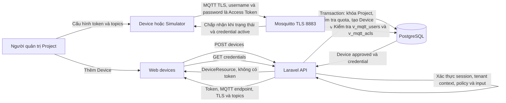
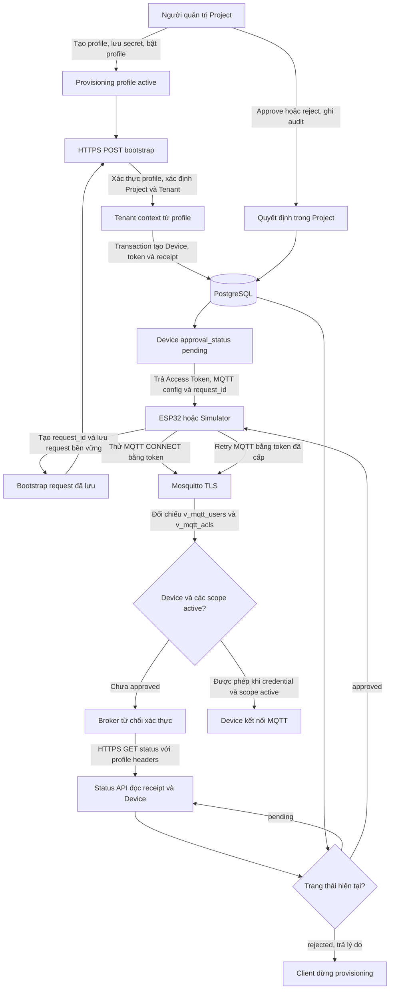

# Device Access Token: cơ sở và luồng hoạt động

Tài liệu này mô tả hành vi hiện tại theo contract và mã nguồn LiteBoard: cách Access Token xác thực Device qua MQTT, cách tạo Device thủ công, và cách firmware đăng ký bằng provisioning.

## 1. Các khái niệm và ranh giới

| Khái niệm | Phạm vi | Dùng để làm gì |
|---|---|---|
| `Device` | Một Project trong Tenant | Danh tính và cấu hình của thiết bị; `id` là UUID do backend tạo. |
| Access Token | Một Device | Credential duy nhất để đăng nhập MQTT. Client gửi cùng giá trị làm MQTT username và password. |
| Provisioning profile | Một Project | Cho phép thiết bị mới chứng minh quyền đăng ký vào Project mà không gửi `tenant_id` hay `project_id`. |
| `provision_key` và `provision_secret` | Provisioning profile | Xác thực yêu cầu bootstrap/status. Đây không phải Access Token và không dùng để đăng nhập MQTT. |
| `approval_status` | Một Device | `pending`, `approved` hoặc `rejected`; trạng thái này quyết định Device đã được phép xuất hiện trong MQTT auth view hay chưa. |

<a id="mqtt-authentication"></a>

### Access Token và xác thực MQTT

Backend sinh Access Token bằng `random_int()` từ bảng chữ số và chữ thường, hiện dài 20 ký tự. Đây là secret opaque dùng để chứng minh quyền sở hữu credential, không phải JWT hay OAuth token có claims. Mỗi Device có một row credential hiện hành. Credential lưu SHA-256 của token để tra cứu, bcrypt hash của token để broker kiểm tra password, và bản mã hóa Laravel để API credential có thể trả token cho người có quyền. Token thô không nằm trong Device list resource; endpoint credentials và bootstrap response có trả token nên client cần bảo vệ nó và không ghi vào log.

Device dùng Access Token làm cả MQTT username lẫn password, kết nối tới Mosquitto qua TLS ở cổng `8883`. Đây là TLS xác minh chứng chỉ máy chủ; luồng hiện tại không dùng client certificate/mTLS. MQTT TLS bảo vệ kết nối tới broker, còn HTTPS bảo vệ riêng bootstrap và truy vấn trạng thái duyệt.

Mosquitto tra cứu PostgreSQL qua `v_mqtt_users` và `v_mqtt_acls`. Một credential chỉ được xác thực khi credential đang `active`, Device đang `active` và `approved`, Project đang `active`, Tenant đang `active`. ACL tạo topic từ đúng `project_id` và `device_id`; Device không thể dùng token để truy cập topic của Device khác. Broker cache auth và ACL trên Redis trong 5 giây.

Vì vậy, cấp Access Token không tự động đồng nghĩa với quyền MQTT. Device provisioning có thể đã có token nhưng vẫn bị broker từ chối khi `approval_status` còn `pending` hoặc `rejected`.

### Tenant và quyền truy cập

Device, credential, profile, receipt và audit thuộc Tenant thông qua Project. API quản trị dùng Sanctum, tenant context, route binding lồng Tenant/Project và policy dựa trên vai trò. API bootstrap công khai không nhận Tenant/Project ID: backend tìm profile bằng `provision_key`, lấy Project/Tenant từ profile, rồi đặt tenant context trước khi đọc hoặc ghi dữ liệu. ID do client gửi không thay thế kiểm tra quyền.

Tạo Device thủ công và provisioning dùng chung giới hạn `projects.max_devices_quota`. `null` là không giới hạn; `0` chặn tạo mới. Cả hai đường tạo đều khóa row Project và đếm tất cả Device hiện có trong Project trước khi tạo.

<a id="manual-device-flow"></a>

## Luồng A: Thêm Device thủ công



Ví dụ phần body được chấp nhận:

```json
{
  "name": "Pump room sensor 01",
  "code": "PUMP-ROOM-01",
  "description": "Temperature and vibration sensor",
  "equipment_asset_id": null
}
```

1. Tenant Owner/Admin, Project Admin/Engineer hoặc Platform Admin có quyền ghi tạo thiết bị tại trang `/devices`. Request gửi `name`, `code`, và tùy chọn `description`, `equipment_asset_id`, `status`. Request không được tự gửi `tenant_id`, `project_id`, `approval_status` hay `access_token`.
2. Backend xác thực mã thiết bị duy nhất trong Project. Nếu gắn Equipment Asset, asset phải thuộc chính Project đó và có loại Equipment. Sau đó backend khóa Project, kiểm tra quota, tạo Device và credential trong cùng transaction.
3. Device thủ công không đi qua hàng chờ duyệt: migration đặt `approval_status` mặc định là `approved`; `status` mặc định là `active`. Nếu Device, credential, Project hoặc Tenant không active thì broker vẫn không cấp quyền.
4. Tạo Device trả `DeviceResource`, không trả token. Web mở hộp Device credentials và gọi endpoint credentials riêng để lấy Access Token, broker host, cổng TLS và topics. Việc đọc token được bảo vệ bởi policy quản lý credential.
5. Firmware hoặc simulator cấu hình token làm cả username/password. Các topic được trả về theo Device, thường gồm telemetry, heartbeat, commands và commands acknowledgment. Admin có thể rotate token; token cũ mất hiệu lực sau khi cache broker hết hạn. Credential có thể bị revoke riêng.

Các topic có dạng `liteboard/{project_id}/devices/{device_id}/<channel>`, gồm `telemetry`, `heartbeat`, `commands` và `commands/ack`.

<a id="provisioning-device-flow"></a>

## Luồng B: Provisioning Device mới

Provisioning tự tạo row Device và cùng loại Access Token như luồng thủ công. Khác biệt nằm ở cách gán Project và trạng thái duyệt ban đầu.

### Chuẩn bị profile trong Project

1. Người có quyền ghi mở **Provision devices** hoặc phần provisioning của Project.
2. Backend tạo một profile cho Project, ban đầu `enabled = false`. `provision_key` định danh profile; `provision_secret` là bí mật dùng để xác thực. Backend chỉ lưu hash của secret.
3. Secret được trả về trong response tạo profile hoặc rotate secret; giao diện giữ secret trong session hiện tại để cấu hình thiết bị. API đọc profile sau đó không trả secret.
4. Admin bật profile. Khi profile bị tắt, bootstrap mới bị từ chối; các Access Token đã cấp cho Device không bị thu hồi chỉ vì profile bị tắt.
5. Project quota có thể cấu hình ở cùng giao diện. Rotate profile secret thay secret cũ; thao tác này bị chặn nếu Project còn Device `pending` để tránh làm mất thông tin cần cho luồng duyệt.

### Bootstrap và cấp token

Thiết bị gửi `POST /api/device-provisioning/bootstrap` qua HTTPS với `provision_key`, `provision_secret`, `device_name`, `device_code`, UUID `request_id`, và tùy chọn `firmware_version`. Đây là endpoint không dùng session Sanctum; profile key/secret xác thực yêu cầu, còn throttle giới hạn theo IP và profile. Request không được gửi Tenant/Project ID, Access Token, trạng thái duyệt hoặc các trường credential nội bộ. `device_code` dùng để phát hiện claim trùng, không phải bằng chứng xác thực; ESP32 hiện tạo code từ eFuse MAC.

Ví dụ request (giá trị bí mật chỉ là placeholder):

```json
{
  "provision_key": "<project-profile-key>",
  "provision_secret": "<project-profile-secret>",
  "device_name": "Pump room sensor 01",
  "device_code": "esp32-<efuse-mac>",
  "request_id": "<uuid-generated-and-persisted-by-device>",
  "firmware_version": "1.0.0"
}
```

Backend xác minh profile và secret, rate limit theo IP/profile, rồi kiểm tra profile đang bật và Project/Tenant đang active. Project được lấy từ profile, không từ payload. Trong transaction backend khóa Project/Profile, kiểm tra quota và `device_code`, tạo Device cùng credential rồi đặt Device thành `pending`. Backend ghi receipt chứa fingerprint payload, token hash và hạn hết hạn 24 giờ.

Response thành công trả `credential_type: access_token`, định danh Device, `request_id`, `approval_status`, Access Token, cùng MQTT host/cổng `8883`/TLS/topics. Response có `Cache-Control: no-store`. Token được cấp và lưu ngay, dù Device đang chờ duyệt.

Response rút gọn theo contract:

```json
{
  "status": "success",
  "credential_type": "access_token",
  "device": { "id": "<device-uuid>", "project_id": "<project-uuid>" },
  "provisioning": { "request_id": "<same-uuid>", "approval_status": "pending" },
  "credentials": { "access_token": "<device-access-token>" },
  "mqtt": {
    "host": "<configured-broker-host>",
    "port": 8883,
    "tls": true,
    "topics": {
      "telemetry": "liteboard/<project-id>/devices/<device-id>/telemetry",
      "heartbeat": "liteboard/<project-id>/devices/<device-id>/heartbeat",
      "commands": "liteboard/<project-id>/devices/<device-id>/commands",
      "commands_ack": "liteboard/<project-id>/devices/<device-id>/commands/ack"
    }
  }
}
```

`request_id` là idempotency key trong phạm vi profile. Khi profile vẫn bật và Project/Tenant còn active, retry cùng request ID và cùng payload trong 24 giờ trả lại credential hiện hành; dùng lại ID với payload khác bị từ chối. Sau 24 giờ, bootstrap retry bị từ chối theo `expires_at`; receipt vẫn là căn cứ để status API tìm request đã tạo. `device_code` trùng trong Project và vượt quota cũng bị từ chối. Lỗi rate limit có thể kèm `Retry-After`.



### Duyệt, từ chối và hành vi client

- Người có quyền ghi trong Project duyệt hoặc từ chối Device đang `pending` qua API `/api/tenants/{tenant}/projects/{project}/devices/{device}/approve` hoặc `/reject`. Một quyết định tạo audit; từ chối yêu cầu lý do và lý do đó được trả cho thiết bị qua status API.
- Duyệt đổi `approval_status` thành `approved`; Access Token không đổi. Khi `v_mqtt_users` nhìn thấy trạng thái mới, broker có thể xác thực token đã cấp. Rejection đổi trạng thái thành `rejected`; credential không được xóa, nhưng view loại Device ra nên token không đăng nhập MQTT được. Bootstrap retry cho claim đã bị từ chối trả lỗi.
- Thiết bị hỏi `GET /api/device-provisioning/status?request_id=<uuid>` và gửi `X-Provision-Key` cùng `X-Provision-Secret`. Đây cũng là endpoint không dùng session Sanctum; nó chỉ trả trạng thái và lý do từ chối, không trả lại Access Token.
- ESP32 lưu payload bootstrap đang chờ vào Preferences/NVS trước khi gửi. Sau response thành công, sketch lưu enrollment/token và xóa payload pending. Nếu reboot giữa chừng, request ID và payload đã lưu cho phép retry idempotent. Khi còn pending, sketch thử MQTT; nếu broker từ chối credential, nó hỏi status theo chu kỳ rồi kết nối lại sau khi được duyệt. Khi bị từ chối, sketch dừng luồng kết nối và ghi lý do ra Serial.
- Simulator lưu request/enrollment vào state file để tiếp tục sau restart. Ở provisioning mode, simulator đợi status thành `approved` rồi mới kết nối MQTT; trạng thái `rejected` kết thúc bằng lỗi có lý do.

## 4. Bảo vệ transport và bí mật

- Backend chỉ cho bootstrap/status qua HTTPS, ngoại trừ smoke test local khi `APP_ENV=local` và `DEVICE_PROVISIONING_ALLOW_INSECURE_HTTP=true`. Simulator bắt buộc URL HTTPS; firmware có thể dùng HTTP cho local smoke test nhưng cách đó không kiểm tra CA/SAN.
- Firmware HTTPS xác minh CA của endpoint provisioning; MQTT TLS riêng xác minh CA/hostname của broker. Local/production reverse proxy kết thúc HTTPS không thay đổi contract provisioning. Chỉ phân phối public CA certificate, không đưa private key hoặc profile secret vào firmware mẫu hay Git.
- Profile secret và Access Token có vai trò khác nhau. Profile secret cho phép claim/status trong Project; Access Token chỉ dùng làm MQTT login của một Device. Không ghi một trong hai vào application log.
- Access Token có thể đọc lại qua endpoint credential có policy, vì bản mã hóa được lưu ở database. Rotation thay token hiện hành và cần cập nhật client; revoke chặn kết nối mà không xóa Device.

## 5. Cấu trúc dữ liệu và điểm vào mã nguồn

| Thành phần | Vai trò hiện tại |
|---|---|
| `devices` | Danh tính Device, Project, trạng thái hoạt động và `approval_status`. |
| `device_credentials` | Một credential hiện hành cho mỗi Device; hash tra cứu, password hash cho broker, token mã hóa để cấp cho client được phép. |
| `project_provisioning_profiles` | Profile theo Project, enabled flag, key và secret hash. |
| `device_provisioning_receipts` | Idempotency theo profile/request ID, payload fingerprint, token hash và hạn 24 giờ. |
| `device_provisioning_audits` | Ghi việc quản lý profile/quota và quyết định duyệt/từ chối, gồm actor và lý do. |
| `v_mqtt_users`, `v_mqtt_acls` | Broker xác thực token và giới hạn quyền theo trạng thái Device/Project/Tenant cùng topic của Device. |

Các điểm triển khai để tra cứu luồng: `backend/modules/Admin/Services/Device/DevicePersistenceService.php`, `DeviceCredentialService.php`, `backend/modules/Admin/Services/DeviceProvisioning/DeviceProvisioningService.php`, `DeviceApprovalService.php`, `backend/modules/Admin/Actions/DeviceProvisioning/Http/BootstrapDeviceAction.php`, `backend/database/migrations/2026_09_27_000003_create_mqtt_views.php`, `infrastructure/mosquitto/mosquitto.conf`, `web/app/pages/devices.vue`, `web/app/components/ProjectProvisioningProfileSection.vue`, `simulator/app/provisioning.py` và `ESP32/Provisioning/Provisioning.ino`.

## Tài liệu liên quan

- [Kế hoạch hardening và ingestion](../future_plans/future_device_security_and_ingestion_plan.md)
- [MQTT TLS server certificate](../future_plans/phase-7-mqtt-tls-server-certificate.md)
- [Quota và rate limiting](../future_plans/phase-8-quotas-and-rate-limiting.md)
- [Schema validation và replay protection](../future_plans/phase-9-schema-validation-and-replay-protection.md)
