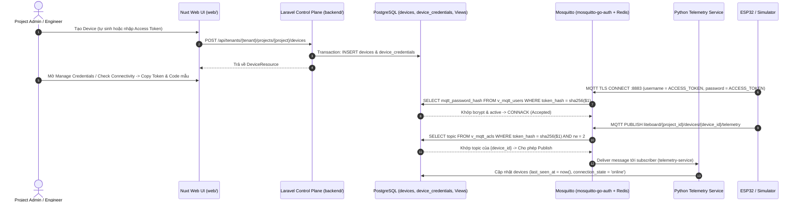

# Access Token: đặc tả, hiện trạng và kế hoạch

> Cập nhật: 2026-10-01
> Phạm vi: Database, Laravel Control Plane, Mosquitto Broker (`mosquitto-go-auth`), Python Data Plane (`telemetry-service`), Simulator/ESP32 và Nuxt Web UI  
> Phương án kiến trúc: **Phương án A** — Sử dụng `iegomez/mosquitto-go-auth` đọc trực tiếp PostgreSQL Views (`v_mqtt_users`, `v_mqtt_acls`) kết hợp Redis cache
> Trạng thái: Access Token CRUD/MQTT baseline đã có; HTTPS provisioning bootstrap chưa triển khai. Xem [mục lục thiết bị](./README.md).

---

## 1. Mục tiêu và Bài toán Kiến trúc

Xây dựng chức năng **Quản lý Thiết bị (Device Registry)** và **Xác thực MQTT bằng Access Token** theo trải nghiệm của **ThingsBoard**, nhưng phù hợp với kiến trúc tách rời Broker của LiteBoard ([docs/plan.md](../../plan.md)) và tuân thủ nghiêm ngặt [docs/DATA_CONTRACT_INTEGRITY_RULE.md](../../DATA_CONTRACT_INTEGRITY_RULE.md) cùng [docs/Request_Handling.md](../../Request_Handling.md).

### 1.1. Luồng nghiệp vụ chuẩn ThingsBoard
1. **Khởi tạo Device & Cấp Access Token (Control Plane)**:
   - Người dùng có quyền (`Platform Admin`, `Tenant Owner/Admin`, hoặc `Project Admin/Engineer`) tạo một `Device` thuộc một `Project` (có thể liên kết tùy chọn với 1 `Asset` có `asset_type = 'equipment'` trong cùng Project).
   - Trong cùng một transaction tạo `Device`, hệ thống tự động tạo bản ghi `DeviceCredential` (`credential_type = 'access_token'`):
     - Luôn tự sinh chuỗi ngẫu nhiên **20 ký tự** từ bảng `0123456789abcdefghijklmnopqrstuvwxyz` bằng CSPRNG; entropy lý thuyết khoảng **103,4 bit** (ví dụ: `0bszem6ntw2bi0d28q1a`).
2. **Quản lý Credential & Kiểm tra kết nối trên Web UI**:
   - Người dùng có thể mở hộp thoại **Manage Credentials** để xem/copy Access Token, sinh token mới (**Rotate / Regenerate**), hoặc thu hồi (**Revoke**). API từ chối request chứa token tùy chỉnh.
   - Hộp thoại **Check Connectivity** sinh sẵn câu lệnh `mosquitto_pub` và đoạn code mẫu `ESP32 (Arduino PubSubClient)` đã điền sẵn `ACCESS_TOKEN`, `PROJECT_ID`, `DEVICE_ID` và topic của thiết bị.
3. **Xác thực MQTT qua TLS & Phân quyền Topic tại Broker (`mosquitto-go-auth`)**:
   - Client chỉ kết nối tới listener TLS `8883`; broker không mở cổng MQTT plaintext `1883` hoặc WebSocket `9001`.
   - Thiết bị kết nối tới Mosquitto bằng `username = <ACCESS_TOKEN>`, `password = <ACCESS_TOKEN>`.
   - Plugin `go-auth.so` của Mosquitto truy vấn trực tiếp 2 View `v_mqtt_users` và `v_mqtt_acls` trên PostgreSQL (có cache Redis 5 giây):
     - **Authentication (`v_mqtt_users`)**: Kiểm tra `token_hash` (`SHA-256`) và xác minh `mqtt_password_hash` (`bcrypt`), đồng thời đảm bảo `DeviceCredential`, `Device`, `Project` và `Tenant` đều đang `active`.
     - **Topic ACL (`v_mqtt_acls`)**: Khóa chặt phạm vi topic theo đúng `{project_id}` và `{device_id}` của Access Token đó:
       - Quyền **Publish (`write`)**:
         - `liteboard/{project_id}/devices/{device_id}/telemetry`
         - `liteboard/{project_id}/devices/{device_id}/heartbeat`
         - `liteboard/{project_id}/devices/{device_id}/commands/ack`
       - Quyền **Subscribe (`read` / `subscribe`)**:
         - `liteboard/{project_id}/devices/{device_id}/commands`
4. **Cập nhật trạng thái Thiết bị tại Data Plane (`telemetry-service`)**:
   - Khi `telemetry-service` nhận gói tin hợp lệ từ thiết bị trên nhánh `liteboard/{project_id}/devices/{device_id}/telemetry` hoặc `heartbeat`, hệ thống cập nhật `last_seen_at` và chuyển `connection_state` sang `'online'`.

---

## 2. Sơ đồ Kiến trúc Tổng thể

---

## 3. Ranh giới Dữ liệu & Bảo mật (Multi-Tenancy & Security Invariants)

1. **Phân loại dữ liệu**:
   - `devices` và `device_credentials` là **tenant-owned data**, được phân vùng thông qua `project_id` (`Tenant` → `Project` → `Device` → `DeviceCredential`).
2. **Không bao giờ tin `tenant_id` hoặc `project_id` từ Request Body**:
   - Mọi thao tác CRUD Device và Credential đều lấy `{tenant}` và `{project}` từ route model binding đã qua `tenant.context` middleware và `scopeBindings()`.
   - Request body gửi kèm `tenant_id` hoặc `project_id` sẽ bị chặn bởi rule `prohibited`.
3. **Bảo mật Lưu trữ Kép cho Access Token**:
   - `encrypted_token` (`text`): Mã hóa AES-256-CBC bằng `APP_KEY` của Laravel (`'encrypted'` cast). Chỉ giải mã khi trả về trong `DeviceCredentialResource` cho người dùng có quyền `manageCredentials`.
   - `token_hash` (`char(64)`, `unique`): Băm một chiều `hash('sha256', $plainToken)` để đánh unique index và tra cứu `O(1)` trên PostgreSQL.
   - `mqtt_password_hash` (`varchar(255)`): Băm `bcrypt` (`$2a$...`) để `mosquitto-go-auth` kiểm tra mật khẩu MQTT.
   - Không bao giờ ghi `plainToken` hoặc `encrypted_token` vào application log, audit log hay message trace.

---

## 4. Danh sách các Phase Triển khai theo Tầng Kiến trúc

Các Phase 1–5 có implementation trong repository; trạng thái acceptance runtime được ghi riêng để không đánh đồng code/configuration với broker end-to-end. Tài liệu từng phase nằm trong [`access_token_progress/`](./access_token_progress/):

| Phase | Tầng kiến trúc | File đặc tả chi tiết | Phụ thuộc | Trạng thái |
|---|---|---|---|---|
| **Phase 1** | **Database & PostgreSQL Views** (`backend/database/`) | [phase-1-database-and-sql-views.md](./access_token_progress/phase-1-database-and-sql-views.md) | `projects`, `assets` | `Completed` |
| **Phase 2** | **Laravel Control Plane API** (`backend/modules/Admin/`) | [phase-2-laravel-control-plane.md](./access_token_progress/phase-2-laravel-control-plane.md) | Phase 1 | `Completed` |
| **Phase 3** | **MQTT Broker Auth & ACL** (`infrastructure/mosquitto/`, `docker-compose.yml`) | [phase-3-mqtt-broker-mosquitto-go-auth.md](./access_token_progress/phase-3-mqtt-broker-mosquitto-go-auth.md) | Phase 1 | Implemented; broker runtime recheck required |
| **Phase 4** | **Python Data Plane & Simulator/ESP32** (`telemetry-service/`, `simulator/`) | [phase-4-telemetry-data-plane-and-edge.md](./access_token_progress/phase-4-telemetry-data-plane-and-edge.md) | Phase 2, Phase 3 | Core flow implemented; TLS broker E2E pending |
| **Phase 5** | **Nuxt 4 Web UI** (`web/`) | [phase-5-nuxt-web-ui.md](./access_token_progress/phase-5-nuxt-web-ui.md) | Phase 2 | `Completed` |

---

## 4.1. HTTPS Access Token provisioning (planned)

[Phase 6: HTTPS Access Token provisioning](./access_token_progress/phase-6-https-access-token-provisioning.md) is the next Access Token feature. It adds a Project-scoped provisioning profile and a public HTTPS bootstrap endpoint that creates the Device and issues the existing Access Token credential. It is **not implemented**.

The repository also contains TLS server-auth configuration for MQTT `8883`. Track that transport baseline separately: configuration and local certificate checks do not by themselves prove the broker runtime acceptance criteria. Do not conflate it with provisioning.

## 4.2. Separate future tracks

| Track | Scope | Specification | Status |
|---|---|---|---|
| MQTT Basic | Separate `clientId`/username/password mode and strict client-ID binding | [MQTT Basic plan](./mqtt_basic_progress/mqtt-basic-and-client-id-plan.md) | Future plan; not implemented |
| Phase 7 | X.509/mTLS and certificate rotation | [Phase 7](./future_plans/phase-7-tls-8883-x509-and-cert-rotation.md) | Future plan |
| Phase 8 | Message/connection quotas and per-device rate limits | [Phase 8](./future_plans/phase-8-quotas-and-rate-limiting.md) | Future plan |
| Phase 9 | Telemetry schema validation and replay/deduplication | [Phase 9](./future_plans/phase-9-schema-validation-and-replay-protection.md) | Future plan |

See the [future hardening roadmap](./future_plans/future_device_security_and_ingestion_plan.md) for cross-track dependencies. MQTT Basic is deliberately not assigned to Phase 6 of the Access Token plan.

---

## 5. Tiêu chí Nghiệm thu Tổng thể (End-to-End Acceptance Criteria)

- [x] **Phase 1**: Migration chạy thành công, tạo đầy đủ bảng `devices`, `device_credentials` và 2 View `v_mqtt_users`, `v_mqtt_acls` trên PostgreSQL; không sử dụng `down()`.
- [x] **Phase 2**: Toàn bộ REST API CRUD Device và Manage Credentials (`show`, `update`, `rotate`) hoạt động đúng contract; pass `composer stan`, `composer test` và `composer pint`.
- [x] **Phase 3**: Mosquitto (`mosquitto-go-auth`) chặn kết nối ẩn danh; thiết bị dùng đúng `ACCESS_TOKEN` chỉ publish/subscribe được vào topic của chính `{project_id}` và `{device_id}` đó; token bị `revoke` hoặc `rotate` mất quyền truy cập sau khi hết TTL cache (5s).
- [x] **Phase 4**: `telemetry-service` kết nối bằng tài khoản nội bộ, nhận gói tin trên `liteboard/+/devices/+/telemetry` và `heartbeat`, cập nhật `last_seen_at` và `connection_state = 'online'`; `simulator` và `Base.ino` gửi dữ liệu thành công bằng `ACCESS_TOKEN`.
- [x] **Phase 5**: Giao diện Nuxt UI (`/devices`) cho phép CRUD Device, gắn Equipment Asset, Copy/Rotate/Revoke Access Token và hiển thị lệnh `mosquitto_pub` / code `ESP32` trong hộp thoại Check Connectivity.
- [ ] **HTTPS Access Token bootstrap**: Profile, enrollment, idempotency, quota và simulator/ESP32 bootstrap chưa được triển khai/ nghiệm thu.
- [ ] **MQTT TLS server-auth runtime**: Xác nhận broker thực tế chấp nhận client hợp lệ qua `8883` và từ chối CA/hostname sai cùng plaintext `1883`/`9001` bằng artifact broker đã pin.
