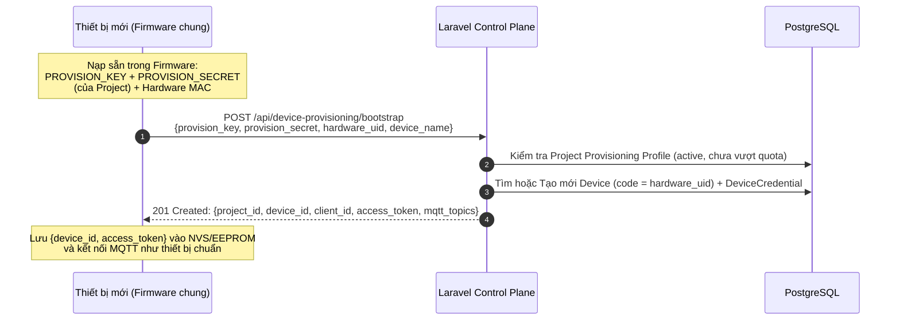

# Phase 6: MQTT TLS, MQTT Basic Credentials, Ràng buộc `clientId` & Device Provisioning Bootstrap

> Thuộc kế hoạch tương lai: [future_device_security_and_ingestion_plan.md](../future_device_security_and_ingestion_plan.md)  
> Tầng kiến trúc: **Database + Laravel Control Plane + Mosquitto/EMQX ACL + Edge Firmware**  
> Phụ thuộc: Hoàn thành Phase 1 → Phase 5  
> Trạng thái: Cấu hình broker, client TLS server-auth và kiểm tra cục bộ đã hoàn tất; nghiệm thu broker end-to-end còn chờ Docker Engine. MQTT Basic, bind `clientId` và provisioning vẫn là kế hoạch.

---

## 1. Mục tiêu của Phase 6

Giải quyết các bài toán bảo vệ đường truyền, định danh và cấp phát thiết bị ở quy mô lớn:
1. **MQTT Basic Credential Mode riêng (`mqtt_basic`)**: Hỗ trợ các thiết bị PLC / Gateway công nghiệp yêu cầu cấu hình `Client ID`, `Username` và `Password` riêng biệt.
2. **Bind `clientId` ↔ `device`**: Khóa chặt `MQTT Client ID` với bản ghi `Device` để ngăn chặn giả mạo phiên kết nối hoặc hai thiết bị dùng chung `clientId` gây rớt mạng liên tục.
3. **Device Provisioning Bootstrap**: Cho phép thiết bị mới xuất xưởng tự động đăng ký (Zero-Touch Provisioning) vào đúng `Project` mà không cần nạp tay từng `Access Token` khi flash firmware.
4. **Bắt buộc MQTT qua TLS**: Mọi client kết nối broker qua listener TLS `8883`; broker không mở listener plaintext `1883` hoặc WebSocket `9001`.

---

## 2. Thiết kế Kỹ thuật Chi tiết

### 2.1. MQTT Basic Credential Mode riêng (`credential_type = 'mqtt_basic'`)

#### Mở rộng Schema bảng `device_credentials`
Bổ sung migration thêm các cột cho chế độ `mqtt_basic`:
```text
device_credentials (bổ sung)
  credential_type   varchar(32) -- 'access_token' | 'mqtt_basic' | 'x509'
  mqtt_client_id    varchar(128) NULLABLE UNIQUE
  mqtt_username     varchar(128) NULLABLE UNIQUE
  token_hash        char(64) NULLABLE UNIQUE  -- NULL nếu chỉ dùng mqtt_basic không có access_token
```

#### Cập nhật View `v_mqtt_users`
Hỗ trợ tra cứu đồng thời cả thiết bị dùng `access_token` và thiết bị dùng `mqtt_basic`:
- Khi `credential_type = 'access_token'`: định danh đăng nhập (`login_key`) là `token_hash`.
- Khi `credential_type = 'mqtt_basic'`: định danh đăng nhập là ` encode(sha256(convert_to(mqtt_username, 'UTF8')), 'hex')`.

---

### 2.2. Bind `clientId` ↔ `device`

#### Vấn đề
Trong MQTT chuẩn, nếu thiết bị A biết hoặc dùng lại thông tin đăng nhập và đặt `clientId` trùng với thiết bị B đang online, Broker sẽ ngắt kết nối của thiết bị B ngay lập tức (Session Takeover).

#### Giải pháp
1. **Quy định `expected_client_id` trên mỗi Device**:
   - Nếu `mqtt_client_id` được khai báo tường minh: bắt buộc `clientId == mqtt_client_id`.
   - Nếu dùng `access_token`: khuyến nghị `clientId == device.id` (hoặc `device.code`).
2. **Kiểm tra tại tầng Broker**:
   - Với **Mosquitto (`mosquitto-go-auth`)**: Trong `auth_opt_pg_aclquery`, ngoài `$1` (`username`) và `$2` (`rw`), có thể truyền `$c` (`clientid`) hoặc nhúng `%c` trong topic pattern nếu cấu hình theo `clientid`:
     ```sql
     SELECT topic
     FROM v_mqtt_acls
     WHERE login_hash = encode(sha256(convert_to($1, 'UTF8')), 'hex')
       AND (expected_client_id IS NULL OR expected_client_id = $3)
       AND rw = $2
     ```
   - Với **EMQX Profile**: EMQX hỗ trợ biến `${clientid}` và `${username}` trực tiếp trong câu lệnh SQL Auth (`WHERE login_hash = sha256(${username}) AND (expected_client_id IS NULL OR expected_client_id = ${clientid})`), từ chối ngay từ bước `CONNECT` nếu `clientId` không khớp!

---

### 2.3. Device Provisioning Bootstrap (Zero-Touch Provisioning)

#### Luồng hoạt động


#### Thiết kế Bảng `project_provisioning_profiles`
```text
project_provisioning_profiles
  id                        uuid PRIMARY KEY
  project_id                uuid NOT NULL UNIQUE FK -> projects.id
  enabled                   boolean NOT NULL DEFAULT false
  provision_key             varchar(64) NOT NULL UNIQUE
  provision_secret_hash     varchar(255) NOT NULL
  encrypted_provision_secret text NOT NULL
  max_provisioned_devices   integer NOT NULL DEFAULT 100
  provisioned_count         integer NOT NULL DEFAULT 0
  created_at                timestamptz
  updated_at                timestamptz
```

#### Bảo mật cho Provisioning Endpoint
- Endpoint `POST /api/device-provisioning/bootstrap` áp dụng rate limit nghiêm ngặt theo IP và `provision_key` (ví dụ: tối đa 10 lần/phút).
- Nếu `hardware_uid` đã từng được provision trước đó:
  - Mặc định trả về `409 Conflict` (`DEVICE_ALREADY_PROVISIONED`) để chống kẻ tấn công đoán `hardware_uid` (MAC address) nhằm lấy lại `access_token` của thiết bị đang chạy!
  - Muốn cấp lại (Re-provision), Admin phải bấm **Allow Re-claim** hoặc xóa/reset thiết bị trên Web UI.

### 2.4. Bảo vệ đường truyền MQTT bằng TLS server-auth
- Mọi client kết nối broker qua TLS 1.2 trở lên trên cổng `8883`, xác minh CA và hostname/SAN của broker.
- Mosquitto giữ server certificate/private key; client chỉ nhận CA certificate công khai. Phase này không bật mTLS nên MQTT username/password và ACL hiện có vẫn được giữ.
- Broker không có listener plaintext `1883` hoặc WebSocket `9001`. PLC cần hỗ trợ MQTT TLS hoặc dùng gateway chuyển đổi giao thức và publish tới `8883` qua TLS.
- Chứng chỉ development được tạo bởi `infrastructure/mosquitto/generate-dev-certs.ps1`. Production dùng chứng chỉ hợp lệ với hostname broker; private key không đặt trong Git hoặc firmware.
- Endpoint bootstrap chỉ được đưa vào vận hành khi dùng HTTPS trước khi gửi `provision_secret` hoặc nhận access token. MQTT TLS không mã hóa HTTP request.

---

## 3. Checklist Nghiệm thu Phase 6

- [x] Development CA/server certificate sinh được; SAN hợp lệ và OpenSSL từ chối hostname hoặc CA không tin cậy.
- [x] Cấu hình Mosquitto chỉ có listener TLS `8883`; Compose chỉ publish `8883` và không khai báo listener/port mapping `1883` hoặc `9001`.
- [x] `telemetry-service` và simulator có TLS context bắt buộc CA tin cậy, hostname hợp lệ và TLS 1.2 trở lên; test đạt 3/3 cho mỗi service.
- [x] Mẫu ESP32 dùng `WiFiClientSecure`, CA công khai và cổng `8883`; chưa biên dịch/chạy trên board thật.
- [ ] End-to-end: broker chỉ nhận TLS `8883`; kết nối `1883`/`9001` thất bại.
- [ ] End-to-end: `telemetry-service`, simulator, healthcheck và ESP32 kết nối TLS, giữ nguyên Access Token/ACL.
- [ ] Có thể chọn loại credential `Access Token` hoặc `MQTT Basic` (`Client ID` + `Username` + `Password`) trên Web UI và API.
- [ ] Thiết bị kết nối sai `clientId` đã gắn với Device bị từ chối quyền truy cập.
- [ ] Thiết bị mới gọi `POST /api/device-provisioning/bootstrap` với `provision_key` và `provision_secret` hợp lệ sẽ tự động tạo bản ghi `Device` trong Project và nhận về `access_token` một lần duy nhất.
- [ ] Gọi lại API provisioning lần thứ 2 cho cùng `hardware_uid` bị từ chối (`409 Conflict`) để bảo vệ thiết bị đang hoạt động.

> Giới hạn nghiệm thu hiện tại: `docker compose config --quiet` và kiểm tra chứng chỉ cục bộ đã qua, nhưng chưa chạy broker/client trong Docker vì Docker Engine từ chối truy cập qua named pipe. Do đó chưa xác nhận kết nối TLS/ACL thực tế hoặc việc `1883`/`9001` bị từ chối ở runtime.
