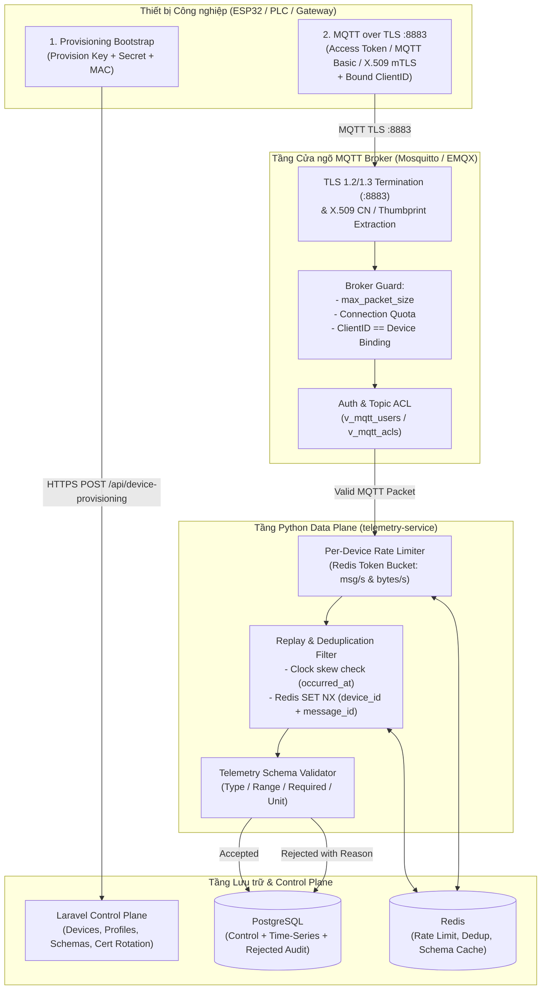

# Kế hoạch Phát triển Tương lai (Future Roadmap): Bảo mật Nâng cao, Provisioning, Quotas & Toàn vẹn Telemetry

> Phiên bản: 2026-09-27  
> Phạm vi: Mở rộng sau MVP Access Token (Phase 1 – Phase 5)  
> Liên kết gốc: [access_token_plan.md](./access_token_plan.md) | [docs/plan.md](../../plan.md)

---

## 1. Bối cảnh & Mục tiêu

Sau khi hoàn thành **Phase 1 → Phase 5** (đăng ký và xác thực thiết bị bằng `Access Token` cơ bản qua `mosquitto-go-auth`), hệ thống đã giải quyết được luồng kết nối chuẩn cho môi trường phát triển và thử nghiệm nội bộ (L0/L1).

Tuy nhiên, để đưa LiteBoard lên môi trường **Industrial IoT / Production** thực tế (nhiều nhà máy, kết nối qua mạng công cộng, chống tấn công DoS/Replay, quản lý hàng nghìn thiết bị), hệ thống cần bổ sung **11 năng lực bảo mật và kiểm soát luồng dữ liệu** được chia thành **4 Phase tiếp theo (Phase 6 → Phase 9)**:

| STT | Hạng mục chức năng | Thuộc Phase | Tầng kiến trúc chịu trách nhiệm chính |
|---:|---|---|---|
| 1 | **MQTT Basic credential mode riêng** | [Phase 6](./access_token_progress/phase-6-mqtt-basic-clientid-and-provisioning.md) | Database + Laravel Control Plane + Broker |
| 2 | **Bind `clientId` ↔ `device`** | [Phase 6](./access_token_progress/phase-6-mqtt-basic-clientid-and-provisioning.md) | Database + Mosquitto/EMQX ACL + Data Plane |
| 3 | **Device Provisioning Bootstrap** | [Phase 6](./access_token_progress/phase-6-mqtt-basic-clientid-and-provisioning.md) | Laravel Control Plane + Edge Firmware |
| 4 | **TLS MQTT 8883** | [Phase 7](./access_token_progress/phase-7-tls-8883-x509-and-cert-rotation.md) | Mosquitto/EMQX TLS Listener + Edge Firmware |
| 5 | **X.509 Certificate Authentication (mTLS)** | [Phase 7](./access_token_progress/phase-7-tls-8883-x509-and-cert-rotation.md) | Broker TLS + PostgreSQL (`device_credentials`) |
| 6 | **Certificate Rotation** | [Phase 7](./access_token_progress/phase-7-tls-8883-x509-and-cert-rotation.md) | Laravel Control Plane + Broker + Edge |
| 7 | **Message-size Quota** | [Phase 8](./access_token_progress/phase-8-quotas-and-rate-limiting.md) | Mosquitto (`max_packet_size`) + `telemetry-service` |
| 8 | **Connection Quota** | [Phase 8](./access_token_progress/phase-8-quotas-and-rate-limiting.md) | Broker Listener / EMQX + Redis Connection Tracker |
| 9 | **Rate Limiting per Device** | [Phase 8](./access_token_progress/phase-8-quotas-and-rate-limiting.md) | `telemetry-service` + Redis Token Bucket |
| 10 | **Telemetry Schema Validation** | [Phase 9](./access_token_progress/phase-9-schema-validation-and-replay-protection.md) | Laravel (`telemetry_schemas`) + `telemetry-service` |
| 11 | **Replay & Deduplication Protection** | [Phase 9](./access_token_progress/phase-9-schema-validation-and-replay-protection.md) | `telemetry-service` + Redis + PostgreSQL |

---

## 2. Kiến trúc Tổng thể khi Hoàn thiện cả 11 Hạng mục

---

## 3. Tóm tắt Giải pháp Kỹ thuật cho 11 Hạng mục

### Nhóm 1: Định danh, Đa phương thức Xác thực & Tự động Đăng ký ([Phase 6](./access_token_progress/phase-6-mqtt-basic-clientid-and-provisioning.md))

1. **MQTT Basic Credential Mode riêng (`credential_type = 'mqtt_basic'`)**:
   - Nhiều PLC công nghiệp (Siemens S7, Mitsubishi, Modbus-MQTT Gateway) bắt buộc cấu hình tách biệt `Client ID`, `Username`, và `Password` thay vì chỉ dùng 1 Access Token.
   - Mở rộng bảng `device_credentials` thêm cột `mqtt_username` (nullable, unique) và `mqtt_client_id` (nullable, unique).
   - View `v_mqtt_users` hỗ trợ cả 2 chế độ: nếu `credential_type = 'access_token'` thì đối chiếu theo `token_hash`; nếu `credential_type = 'mqtt_basic'` thì đối chiếu theo `mqtt_username` + `mqtt_password_hash`.

2. **Bind `clientId` ↔ `device` (Chống mạo danh & xung đột kết nối)**:
   - Nếu không khóa `clientId`, 2 thiết bị có thể vô tình dùng trùng `clientId` gây hiện tượng đá nhau liên tục (reconnect storm), hoặc thiết bị A giả mạo `clientId` của thiết bị B.
   - Giải pháp: Lưu `expected_client_id` (mặc định là `device.id` hoặc `device.code` hoặc `mqtt_client_id`). Trong `v_mqtt_acls` / cấu hình Broker, ép buộc `clientId` (`%c`) khi kết nối phải khớp với bản ghi `Device`.

3. **Device Provisioning Bootstrap (Zero-Touch Provisioning)**:
   - Khi sản xuất hàng loạt 500 mạch ESP32, không thể nạp tay từng `ACCESS_TOKEN` và `DEVICE_ID` riêng vào từng mạch.
   - Giải pháp giống ThingsBoard Device Provisioning:
     - Cấp cho `Project` (hoặc `DeviceProfile`) cặp `provisioning_key` + `provisioning_secret` (có thể bật/tắt bất cứ lúc nào).
     - Mạch ESP32 mới xuất xưởng chỉ chứa `provisioning_key`, `provisioning_secret` và `serial_number`/`mac_address`.
     - Khi khởi động lần đầu, mạch gọi `POST /api/device-provisioning/claim` → Laravel tự tạo bản ghi `Device` + `DeviceCredential` và trả về `{ device_id, project_id, access_token, mqtt_topics }` để mạch lưu vào bộ nhớ Flash (NVS) và dùng cố định từ đó về sau.

---

### Nhóm 2: Bảo mật Đường truyền & Chứng chỉ Số X.509 ([Phase 7](./access_token_progress/phase-7-tls-8883-x509-and-cert-rotation.md))

4. **TLS MQTT 8883**:
   - Toàn bộ gói tin MQTT trên cổng `1883` đi qua mạng dưới dạng bản rõ (plain text) — kẻ tấn công bắt gói tin (sniffing) sẽ đọc được ngay `ACCESS_TOKEN`.
   - Mở cổng `8883` trên Mosquitto với chứng chỉ Server TLS (`ca.crt`, `server.crt`, `server.key`, hỗ trợ Let's Encrypt hoặc Internal CA). Cổng `1883` chỉ giữ trong mạng nội bộ Docker hoặc khóa hoàn toàn trên Production.

5. **X.509 Certificate Authentication (`mTLS`, `credential_type = 'x509'`)**:
   - Ở cấp độ bảo mật cao nhất, thiết bị không gửi mật khẩu mà dùng cặp khóa bất đối xứng (`client.crt` + `client.key`).
   - Trên listener `8883`, bật `require_certificate true` và `use_identity_as_username true` (hoặc kiểm tra SHA-256 thumbprint của chứng chỉ).
   - Lưu `cert_common_name` và `cert_sha256_fingerprint` trong `device_credentials`.

6. **Certificate Rotation (Xoay vòng Chứng chỉ không gián đoạn)**:
   - Chứng chỉ X.509 đều có ngày hết hạn (`not_after` / `expires_at`). Nếu chỉ lưu 1 chứng chỉ duy nhất, khi đổi chứng chỉ mới thiết bị sẽ mất kết nối trước khi kịp cập nhật.
   - Cho phép 1 Device có **2 bản ghi credential trong giai đoạn chuyển giao (Grace Period)**: 1 bản ghi `active` (chứng chỉ hiện tại) và 1 bản ghi `pending_rotation` (chứng chỉ mới). Khi thiết bị kết nối thành công bằng chứng chỉ mới, hệ thống tự động thu hồi (`revoked`) chứng chỉ cũ.

---

### Nhóm 3: Kiểm soát Tài nguyên, Quotas & Chống DoS ([Phase 8](./access_token_progress/phase-8-quotas-and-rate-limiting.md))

7. **Message-size Quota**:
   - Chặn thiết bị lỗi hoặc bị tấn công gửi gói tin JSON khổng lồ làm tràn RAM của Broker và `telemetry-service`.
   - Hai lớp chặn:
     - **Lớp Broker (`mosquitto.conf`)**: `max_packet_size 65536` (64 KB cứng toàn cục).
     - **Lớp Data Plane (`telemetry-service`)**: Kiểm tra `len(payload) <= profile.max_payload_bytes` (ví dụ mặc định `4096` bytes cho cảm biến thường).

8. **Connection Quota**:
   - Ngăn một Tenant/Project hoặc một thiết bị bị lỗi vòng lặp mở hàng nghìn kết nối TCP làm cạn kiệt file descriptors của Broker.
   - Giới hạn:
     - Tối đa **1 kết nối đồng thời trên mỗi `device_id`** (kết nối mới đẩy kết nối cũ hoặc từ chối nếu sai `clientId`).
     - Giới hạn tổng số kết nối đang `online` trên mỗi `Project` / `Tenant` (`max_active_devices` trong cấu hình gói cước của Tenant).

9. **Rate Limiting per Device**:
   - Ngăn một thiết bị gửi 1.000 bản tin/giây làm nghẽn hàng đợi ghi Database của các thiết bị khác (Noisy Neighbor problem).
   - Tại `telemetry-service`, áp dụng thuật toán **Token Bucket bằng Redis Lua Script** theo từng `device_id` (ví dụ: tối đa `5 msg/s` và `16 KB/s` mỗi thiết bị). Các gói tin vượt ngưỡng bị đánh dấu `rate_limited` và hủy ngay tại biên trước khi chạm vào PostgreSQL.

---

### Nhóm 4: Toàn vẹn Dữ liệu Telemetry & Chống Phát lại ([Phase 9](./access_token_progress/phase-9-schema-validation-and-replay-protection.md))

10. **Telemetry Schema Validation**:
    - Gắn mỗi `Device` (hoặc `DeviceProfile`) với một `TelemetrySchema` có phiên bản (`schema_version`).
    - Định nghĩa rõ từng metric key: `type` (`float`, `integer`, `boolean`, `string`), `required` (`true`/`false`), miền giá trị (`min`, `max`), và `unit`.
    - Gói tin sai kiểu dữ liệu hoặc vượt ngưỡng vật lý (ví dụ `temperature: "abc"` hoặc `temperature: 99999`) bị từ chối với mã lỗi tường minh (`INVALID_TYPE`, `OUT_OF_RANGE`, `MISSING_REQUIRED_FIELD`).

11. **Replay & Deduplication Protection**:
    - **Chống Replay Attack**: Kiểm tra `occurred_at` trong gói tin so với `received_at` của server. Từ chối gói tin quá cũ (ví dụ cũ hơn `24h` hoặc ngoài cửa sổ cho phép) hoặc có thời gian trong tương lai quá `5 phút` (clock skew).
    - **Chống trùng lặp (Idempotency / Deduplication)**: Khi MQTT gửi ở mức `QoS 1`, nếu mạng chập chờn thiết bị sẽ gửi lặp lại cùng một gói tin.
      - Kiểm tra nhanh trên Redis: `SET dedup:{device_id}:{message_id} 1 NX EX 86400`.
      - Chốt chặn cuối cùng tại PostgreSQL: `UNIQUE (device_id, message_id)` trên bảng lưu trữ telemetry.

---

## 4. Lộ trình Triển khai Chi tiết (Phase 6 → Phase 9)

- **[Phase 6: MQTT Basic, Khóa ClientID & Device Provisioning Bootstrap](./access_token_progress/phase-6-mqtt-basic-clientid-and-provisioning.md)**
- **[Phase 7: Bảo mật TLS 8883, Xác thực Chứng chỉ X.509 & Xoay vòng Chứng chỉ](./access_token_progress/phase-7-tls-8883-x509-and-cert-rotation.md)**
- **[Phase 8: Connection Quota, Message-Size Quota & Rate Limiting theo Thiết bị](./access_token_progress/phase-8-quotas-and-rate-limiting.md)**
- **[Phase 9: Telemetry Schema Validation & Chống Replay / Trùng lặp Gói tin](./access_token_progress/phase-9-schema-validation-and-replay-protection.md)**
