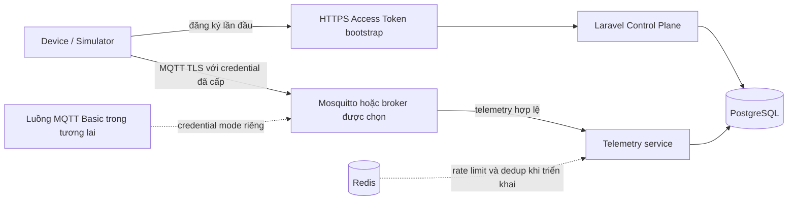

# Roadmap tương lai: Bảo mật Device và toàn vẹn Telemetry

> Cập nhật: 2026-10-01  
> Trạng thái: Tài liệu kế hoạch. Các hạng mục chưa triển khai trừ khi tài liệu phụ ghi rõ trạng thái khác.  
> Điều hướng: [Đặc tả Device](../README.md).

## 1. Hiện trạng và phạm vi

Quản lý Device bằng Access Token, broker authentication/ACL, luồng telemetry và web UI đã có implementation theo [kế hoạch Access Token](../access_token_plan.md). Cấu hình MQTT TLS server-auth đã có, nhưng cần xác minh broker runtime bằng đúng broker artifact trước khi kết luận đã nghiệm thu.

Hạng mục Access Token tiếp theo là [Phase 6: HTTPS bootstrap](../access_token_progress/phase-6-https-access-token-provisioning.md). Hạng mục này tạo Device trong Project của provisioning profile và trả credential Access Token hiện có. Đây không phải MQTT Basic provisioning.

Roadmap này theo dõi các hạng mục riêng hoặc triển khai sau:

| Luồng | Phạm vi | Trạng thái | Đặc tả |
|---|---|---|---|
| MQTT Basic | `clientId`, username, password riêng; có thể thêm ràng buộc client ID và MQTT provisioning | Kế hoạch tương lai, chưa triển khai | [Kế hoạch MQTT Basic](../mqtt_basic_progress/mqtt-basic-and-client-id-plan.md) |
| Phase 7 | Credential X.509/mTLS và rotate certificate | Kế hoạch tương lai | [Phase 7](./phase-7-tls-8883-x509-and-cert-rotation.md) |
| Phase 8 | Giới hạn kích thước gói tin, số kết nối và tốc độ gửi theo Device | Kế hoạch tương lai | [Phase 8](./phase-8-quotas-and-rate-limiting.md) |
| Phase 9 | Kiểm tra schema telemetry và chống replay/deduplication | Kế hoạch tương lai | [Phase 9](./phase-9-schema-validation-and-replay-protection.md) |

Không dùng một số Phase để gộp HTTPS Access Token bootstrap, MQTT Basic và TLS server-auth thành một tính năng. Mỗi luồng có contract và tiêu chí nghiệm thu riêng.

## 2. Kiến trúc mục tiêu

## 3. Các hạng mục

### MQTT Basic và client-ID binding

Credential và broker auth hiện chỉ hỗ trợ Access Token. MQTT Basic trong tương lai cần credential type riêng, vòng đời credential, API/UI, broker authentication và topic ACL theo Device. Cần chứng minh broker/auth artifact đã pin từ chối client ID sai ngay tại CONNECT; việc client ID có mặt khi xét ACL không chứng minh được điều đó.

Chưa quyết định thiết bị MQTT Basic dùng HTTPS bootstrap hay một MQTT provisioning transport riêng. Xem [kế hoạch MQTT Basic](../mqtt_basic_progress/mqtt-basic-and-client-id-plan.md).

### Phase 7: X.509/mTLS

Thêm danh tính certificate và khả năng revoke theo Device, listener mTLS riêng và thời gian chuyển tiếp an toàn khi rotate. Access Token và MQTT Basic dùng server-auth TLS phải tiếp tục hoạt động. Xem [Phase 7](./phase-7-tls-8883-x509-and-cert-rotation.md).

### Phase 8: Kiểm soát tài nguyên

Thêm giới hạn packet tại broker/data plane, quota kết nối và rate limit theo Device. Kiểm tra quota phải dùng chung nguồn dữ liệu và không dựa vào bộ đếm thứ hai có thể lệch. Xem [Phase 8](./phase-8-quotas-and-rate-limiting.md).

### Phase 9: Toàn vẹn telemetry

Kiểm tra payload theo schema có version, áp dụng chính sách timestamp và khử trùng lặp gói QoS 1 bằng idempotency key cùng unique constraint bền vững trong database. Xem [Phase 9](./phase-9-schema-validation-and-replay-protection.md).

## 4. Nguyên tắc dùng chung

- Device, credential, profile và quyền truy cập telemetry là dữ liệu tenant-owned thông qua Project. Dùng integration multi-tenancy hiện có để thiết lập organization context.
- Không lấy `project_id` hoặc `tenant_id` do thiết bị gửi làm nguồn phân quyền.
- Giữ tương thích Access Token khi thêm credential mode khác.
- Không ghi provisioning secret, Access Token, MQTT password hoặc private key vào log.
- Serial, `device_code` hay MAC dùng để nhận diện thiết bị; chúng không chứng minh thiết bị sở hữu secret.
- Chỉ đánh dấu một luồng hoàn thành sau khi đạt cả tiêu chí runtime và negative-case trong đặc tả của luồng đó.
