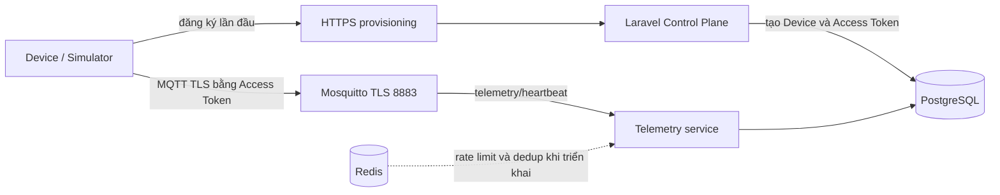

# Roadmap tiếp theo: TLS, quota và toàn vẹn Telemetry

> Cập nhật: 2026-10-07
> Trạng thái: Tài liệu kế hoạch. Chỉ đánh dấu hoàn thành khi có implementation và kiểm tra runtime tương ứng.
> Điều hướng: [Đặc tả Device](../README.md).

## 1. Hiện trạng và thứ tự

Device hiện xác thực MQTT bằng Access Token; mô hình credential, hai luồng tạo Device và tenant boundary được mô tả trong [tài liệu Access Token](../current/devices_access_token.md). Kế hoạch này chỉ theo dõi các phần hardening tiếp theo, gồm TLS production, quota kết nối/tốc độ và toàn vẹn telemetry.

| Phase | Phạm vi | Trạng thái | Đặc tả |
|---|---|---|---|
| Phase 7 | Production-equivalent MQTT TLS server-auth và xoay vòng chứng chỉ máy chủ | TLS local đã có; nghiệm thu production còn mở | [Phase 7](./phase-7-mqtt-tls-server-certificate.md) |
| Phase 8 | Giới hạn kích thước gói tin, số kết nối và tốc độ gửi theo Device | Một phần: quota tạo Device đã có; quota kết nối/tốc độ còn mở | [Phase 8](./phase-8-quotas-and-rate-limiting.md) |
| Phase 9 | Kiểm tra schema telemetry và chống replay/deduplication | Chưa triển khai | [Phase 9](./phase-9-schema-validation-and-replay-protection.md) |
| Phase 10 | Playground MQTT plaintext `1883` | Một phần: broker `mosquitto-plain`, cờ `allow_plaintext` theo từng thiết bị, contract, UI và firmware đã có; còn biên dịch firmware, downlink qua bridge, đo tải auth và firewall production | [Phase 10](./phase-10-mqtt-plaintext-playground.md) |

Provisioning, duyệt Device và quota `projects.max_devices_quota` dùng chung cho tạo thủ công/provisioning đã có implementation. TLS và CA handling cũng đã được cấu hình cho môi trường local. Đây là trạng thái code trong repo; vẫn cần kiểm tra runtime cho từng tiêu chí acceptance bên dưới. Hiện chưa có telemetry persistence/query hoặc replay deduplication trong Data Plane.

Access Token vẫn là credential đăng nhập MQTT duy nhất của Device. Provisioning chỉ cấp credential đó sau khi gán Device vào Project; việc duyệt mới quyết định Device có được MQTT broker cấp quyền hay không.

## 2. Kiến trúc mục tiêu

## 3. Các hạng mục sau provisioning

### Phase 7: MQTT TLS server-auth

Kiểm tra broker bằng artifact đã pin, xác minh CA/hostname, từ chối plaintext và chuẩn bị quy trình xoay vòng chứng chỉ máy chủ. Chứng chỉ máy chủ bảo vệ kết nối TLS; Device vẫn đăng nhập bằng Access Token. Xem [Phase 7](./phase-7-mqtt-tls-server-certificate.md).

### Phase 8: Kiểm soát tài nguyên

Thêm giới hạn packet tại broker/data plane, quota kết nối và rate limit theo Device. Kiểm tra quota phải dùng chung nguồn dữ liệu và không dựa vào bộ đếm thứ hai có thể lệch. Xem [Phase 8](./phase-8-quotas-and-rate-limiting.md).

### Phase 9: Toàn vẹn telemetry

Kiểm tra payload theo schema có version, áp dụng chính sách timestamp và khử trùng lặp gói QoS 1 bằng idempotency key cùng unique constraint bền vững trong database. Xem [Phase 9](./phase-9-schema-validation-and-replay-protection.md).

## 4. Nguyên tắc dùng chung

- Device, credential, provisioning profile và quyền truy cập telemetry là dữ liệu tenant-owned thông qua Project. Dùng integration multi-tenancy hiện có để thiết lập organization context.
- Không lấy `project_id` hoặc `tenant_id` do thiết bị gửi làm nguồn phân quyền; cache, jobs, events và API/UI phải giữ đúng Project/Tenant.
- Không ghi provisioning secret hoặc Access Token vào log.
- Serial, `device_code` hay MAC dùng để nhận diện thiết bị; chúng không chứng minh thiết bị sở hữu secret.
- Chỉ đánh dấu một phase hoàn thành sau khi đạt cả tiêu chí runtime và trường hợp từ chối trong đặc tả của phase đó.
